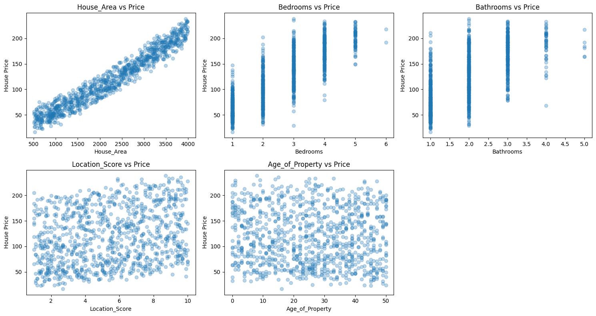
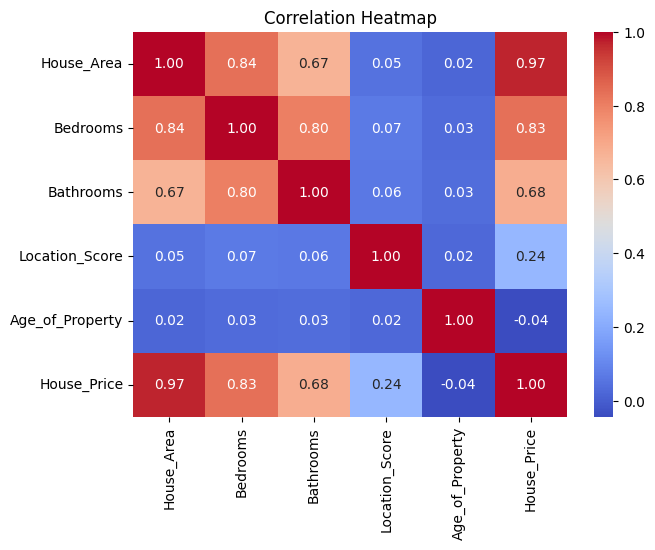
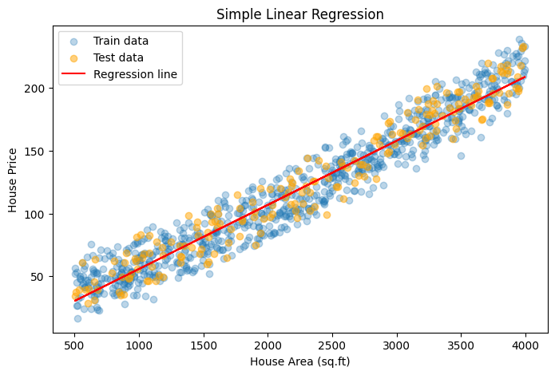
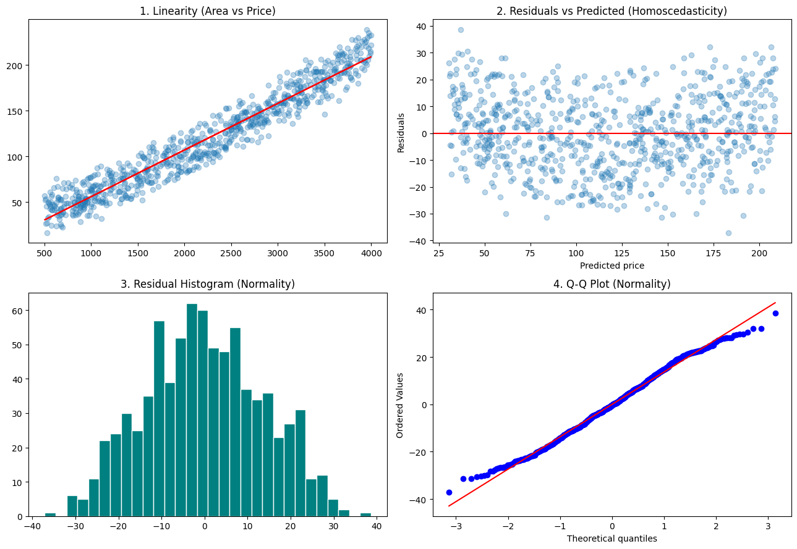
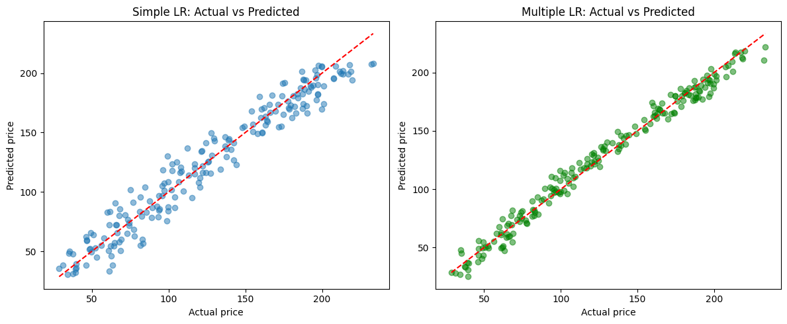
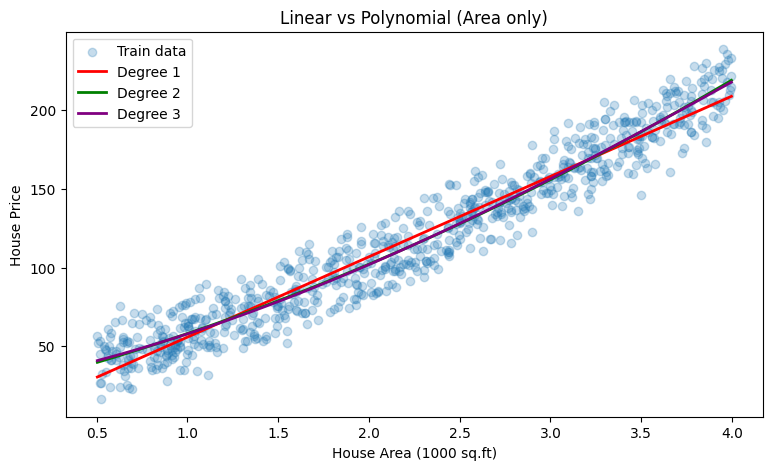
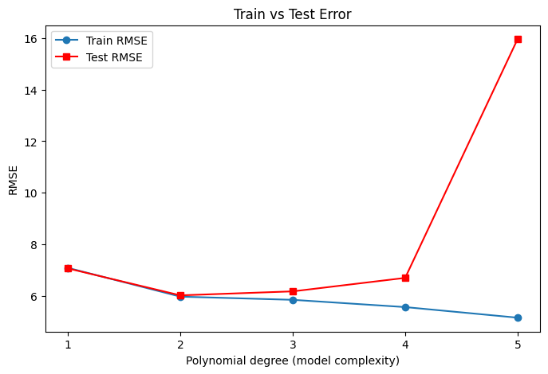
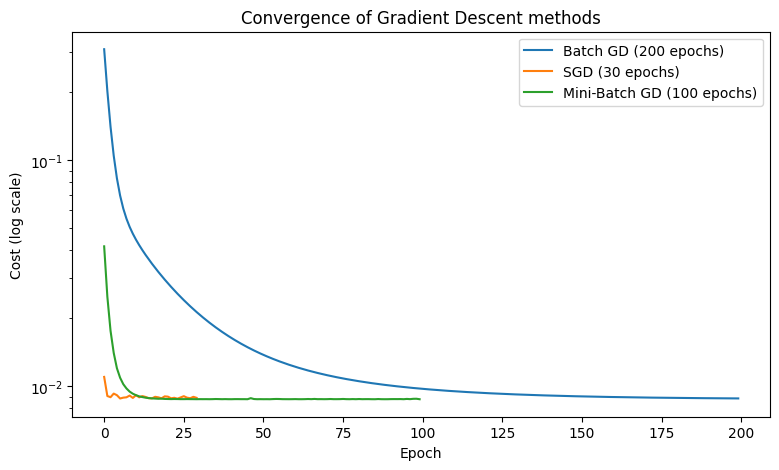
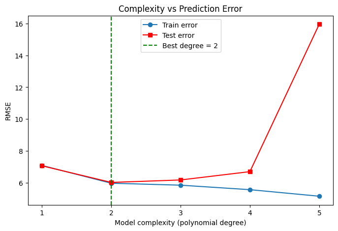
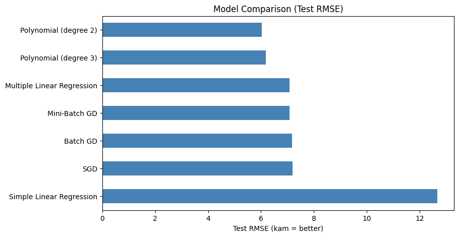

# 🏠 Predictive Insight Engine — House Price Prediction

> **Supervised Learning project** · Regression, Gradient Descent & Bias–Variance analysis
> Role: *Junior Data Scientist at a real-estate analytics firm*

Predict house prices from **size, bedrooms, bathrooms, location score and property age**, compare several supervised-learning models, and explain **why some models perform better than others**.

---

## 📌 Project Overview

| Item | Details |
|---|---|
| Problem type | Supervised learning — **Regression** |
| Target | `House_Price` |
| Features | `House_Area`, `Bedrooms`, `Bathrooms`, `Location_Score`, `Age_of_Property` |
| Models | Simple LR, Multiple LR, Polynomial Regression (deg 2/3, compared up to deg 5), Batch / Stochastic / Mini-Batch Gradient Descent (from scratch) |
| Metrics | MSE, MAE, RMSE, R², Adjusted R² |
| Diagnostics | Linear-regression assumption plots, train-vs-test error (bias / variance), complexity curve |
| Tools | Python, NumPy, Pandas, Matplotlib, Seaborn, SciPy, scikit-learn, Jupyter |

---

## 📁 Repository Structure

```
Predictive-Insight-Engine/
├── Predictive_Insight_Engine.ipynb   # Main notebook (Task 1 to Task 30, task-wise, executed)
├── house_prices.csv                  # Dataset
├── images/                           # Plot screenshots (10 figures)
├── requirements.txt
└── README.md
```

---

## ⚙️ How to Run

```bash
git clone https://github.com/meet6949/Predictive-Insight-Engine.git
cd Predictive-Insight-Engine
pip install -r requirements.txt
jupyter notebook Predictive_Insight_Engine.ipynb
```

Then use **Kernel → Restart & Run All** — the notebook runs cleanly top to bottom (takes well under a minute).

### 📂 About the dataset
The notebook reads `house_prices.csv` from the project folder (columns: `House_Area, Bedrooms, Bathrooms, Location_Score, Age_of_Property, House_Price`).
- The bundled file is a **synthetic dataset** (1000 rows, fixed seed) with the same 6 columns as the assignment.
- To use the **official dataset**, save it as `house_prices.csv` (same column names) and re-run the notebook, then update the numbers in the results tables below.

---

## ✅ Task Coverage

| Part | Tasks | What was done |
|---|---|---|
| **A – Theory** | 1–6 | Supervised learning, regression vs classification, simple linear regression, assumptions, bias–variance, over/underfitting |
| **B – Data prep** | 7–9 | Independent/dependent variables, scatter + correlation plots, 80/20 train-test split |
| **C – Simple LR** | 10–12 | Fit on House Area, regression line, slope/intercept interpretation, assumption checks using 4 plots (linearity, residuals vs predicted, histogram, Q-Q) |
| **D – Metrics** | 13–14 | MSE, MAE, RMSE, R², Adjusted R² (train & test) with interpretation |
| **E – Multiple LR** | 15–17 | All-feature model, coefficient table, comparison with SLR, explanation |
| **F – Polynomial** | 18–20 | Degree 2 & 3, linear vs polynomial (visual + numeric), degree 1–5 train-vs-test comparison |
| **G – Gradient Descent** | 21–25 | Concept, Batch GD, SGD, Mini-Batch GD (all from scratch with NumPy loops), convergence + time comparison |
| **H – Bias–Variance** | 26–28 | Train error (bias) vs train-test gap (variance) for 5 models, complexity vs error, best-balanced model |
| **I – Report** | 29–30 | Final comparison table, short report, conclusion |

---

## 📊 Key Results (bundled dataset, test set = 20%)

| Model | Test RMSE ↓ | Test MAE ↓ | Test R² ↑ | Adj. R² ↑ |
|---|---|---|---|---|
| **Polynomial Regression (deg 2, all features)** 🏆 | **6.03** | 4.92 | **0.988** | 0.987 |
| Polynomial Regression (deg 3, all features) | 6.18 | 5.00 | 0.987 | 0.983 |
| Multiple Linear Regression | 7.07 | 5.69 | 0.983 | 0.983 |
| Mini-Batch GD | 7.09 | 5.70 | 0.983 | 0.983 |
| Stochastic GD | 7.11 | 5.71 | 0.983 | 0.983 |
| Batch GD | 7.18 | 5.82 | 0.983 | 0.983 |
| Simple Linear Regression (Area only) | 12.66 | 10.30 | 0.947 | 0.947 |

**Gradient descent comparison**

| Method | Final cost | Time | Test RMSE |
|---|---|---|---|
| Batch GD (200 epochs) | 0.00883 | ~3 ms | 7.18 |
| Stochastic GD (30 epochs) | 0.00889 | ~70 ms | 7.19 |
| Mini-Batch GD (100 epochs, batch 32) | 0.00876 | ~24 ms | 7.07 |
| sklearn LinearRegression (reference) | – | – | 7.07 |

**Bias–variance (train error = bias, train-test gap = variance)**

| Model | Train RMSE | Test RMSE | Gap |
|---|---|---|---|
| Simple LR | 13.70 | 12.66 | -1.03 |
| Multiple LR | 7.09 | 7.07 | -0.02 |
| **Polynomial deg 2** | 5.98 | **6.03** | 0.05 |
| Polynomial deg 3 | 5.86 | 6.18 | 0.33 |
| Polynomial deg 5 | 5.16 | 15.95 | 10.79 |

*(Timings vary slightly per machine.)*

---

## 🔍 Key Findings

1. **Best model:** degree-2 Polynomial Regression — lowest test error (RMSE ≈ 6.03). Multiple Linear Regression is a very close, simpler and more interpretable runner-up.
2. **Simple LR underfits:** one feature cannot capture price drivers (RMSE 12.66, roughly double the best model). Adding location, age and rooms cut error by ~45%.
3. **Overfitting is real:** moving from degree 2 → 5, train RMSE falls (5.98 → 5.16) while test RMSE shoots up (6.03 → 15.95). 
4. **Gradient descent works:** all three variants reproduce the closed-form solution (test RMSE ≈ 7.1). Mini-Batch is the best practical trade-off; SGD converges in few epochs but is noisy; Batch is smooth but needs more epochs. Feature scaling was essential.
5. **Business meaning:** +100 sq.ft ≈ +4.7 price units, +1 location score ≈ +4.1, each extra year of age ≈ −0.25. Typical error ≈ ±4.9 (MAE).

---

## 🖼️ Screenshots

| | |
|---|---|
|  |  |
|  |  |
|  |  |
|  |  |
|  |  |

---|---|
|  |  |
|  |  |
|  |  |
|  |  |
|  |  |
|  |  |


---

## 🎥 Video Explanation

https://drive.google.com/file/d/1F8z8gbH8VXEsZT4Rbb3rSh-FUtiqsBoM/view?usp=drive_link

---

## 🧠 Theory Summary

- **Supervised learning** – learn `y = f(X)` from labelled data.
- **Regression vs classification** – continuous number vs discrete class.
- **Linear regression assumptions** – linearity, independence, homoscedasticity, normal residuals, no multicollinearity.
- **Bias–variance** – error ≈ Bias² + Variance + noise; simple models → high bias, complex models → high variance.
- **Gradient descent** – `w := w − α∇J(w)`; Batch uses all data, SGD one sample, Mini-Batch a small chunk.

Full definitions and examples are inside **Part A** and **Part G** of the notebook.

